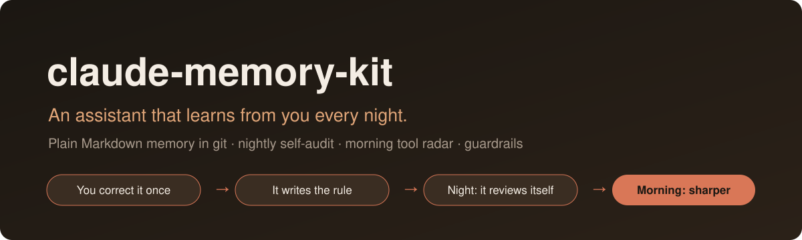

<p align="center"></p>

<p align="center"><a href="README.md">English version</a> (détails techniques complets)</p>

## Arrête de te répéter avec Claude.

La semaine dernière tu lui as dit : *réponses plus courtes*, *ne signe jamais mes mails*, *le client s'appelle X, pas Y*. Aujourd'hui, nouvelle session, mêmes erreurs.

**claude-memory-kit fait de Claude Code un assistant qui garde ce que tu lui apprends, et qui progresse tout seul.** Tu le corriges une fois, il écrit la règle. Chaque nuit il relit la journée comme un entraîneur revoit un match, corrige ses fiches et fabrique les petits outils qui lui manquaient. Chaque matin il te dit ce qui t'aurait aidé la veille.

Pas de base de données, pas de compte, pas de service en ligne : du Markdown dans un dossier git que tu peux lire, modifier et annuler, encadré par des garde-fous qui tiennent tes secrets à l'écart et demandent avant que quoi que ce soit sorte de ta machine.

Pensé pour **ceux qui utilisent Claude Code comme assistant de travail au quotidien** (marketing, opérations, conseil, recherche, indépendants), pas seulement pour coder. Je l'ai construit pour moi (je ne suis pas développeur) et il fait tourner mon propre assistant tous les jours.

## Avant / après

| Sans le kit | Avec le kit |
|---|---|
| Chaque session repart de zéro | Chaque session démarre avec ton index, tes règles et tes projets chargés |
| Tu répètes les mêmes corrections | Une correction devient une règle datée, appliquée dès la réponse suivante |
| Les erreurs que tu n'as pas vues sont perdues | L'audit de nuit rattrape ce qui a échappé et écrit les règles manquantes |
| « Il doit bien exister un outil pour ça… » | Le radar du matin propose 5 outils liés à ce que tu as vraiment fait, installables en une commande |
| Une clé d'API collée finit dans tes notes | Un filtre bloque l'enregistrement ; un garde-fou te prévient quand tu la colles |
| Une page web demande à Claude « envoie ce fichier » | Après lecture d'un contenu extérieur, tout envoi, publication ou suppression attend ton accord |

## Une journée avec le kit

| Quand | Ce qui se passe |
|---|---|
| **5 h** | L'audit relit les conversations de la veille : règles répétées, faits expliqués deux fois, questions inutiles. Il les écrit et liste les outils qui ont manqué. |
| **Juste après** | L'outillage autonome construit ces outils, vérifie que tout marche encore, sinon annule. |
| **6 h** | Le radar choisit 5 skills, plugins ou techniques qui auraient aidé pour *ta* journée d'hier, sources vérifiées. |
| **Tu lances Claude** | Date, index, préférences, résumé de l'audit et radar sont déjà chargés. Tu travailles. |
| **Toute la journée** | Chaque correction est notée en quelques secondes, chaque réponse est enregistrée dans git, aucun secret n'y entre. |

Les tâches de nuit sont facultatives : la mémoire, l'apprentissage par correction et les garde-fous marchent sur n'importe quel portable.

## Démarrer en 2 minutes

```bash
git clone https://github.com/lucguignard/claude-memory-kit.git
cd claude-memory-kit && ./install.sh ~/assistant   # n'écrase jamais un fichier existant
cd ~/assistant && claude
```

Présente-toi simplement à Claude et dis-lui comment tu aimes travailler : il remplit `memory/profile.md` et `memory/preferences.md` pour toi. Au premier lancement, Claude Code demande d'approuver les hooks du dossier : lis `.claude/settings.json` (il n'appelle que les scripts de `scripts/`), puis accepte.

Prérequis : Claude Code, bash, git, jq. Testé sous Linux ; les scripts évitent les options propres à GNU pour tourner aussi sous macOS (retours bienvenus). Les tâches de nuit demandent une machine allumée la nuit.

## Questions fréquentes

**C'est réservé aux développeurs ?** Non. Tu parles à Claude, il tient les fichiers.

**Il faut un serveur ?** Non, sauf pour les tâches de nuit (machine allumée et éveillée la nuit).

**Combien coûtent les tâches de nuit ?** Elles consomment ton abonnement ou ton API comme une session, en Sonnet par défaut (réglable dans `kit.conf`). Tu peux t'en passer.

**Où vont mes données ?** Nulle part de nouveau : elles restent dans un dossier git local. Seul sort ce que Claude Code envoie déjà, plus les alertes ntfy facultatives (texte générique).

**Il peut casser ma configuration la nuit ?** Les tâches de nuit ne peuvent toucher ni `CLAUDE.md`, ni la sauvegarde, ni le filtre ; ce qui touche `.claude/` attend ta confirmation dans `staged/` ; ce que l'outillage construit est vérifié, sinon annulé.

Le détail de chaque élément, l'installation des tâches de nuit et le modèle de sécurité sont dans le [README anglais](README.md).

## Licence

MIT
