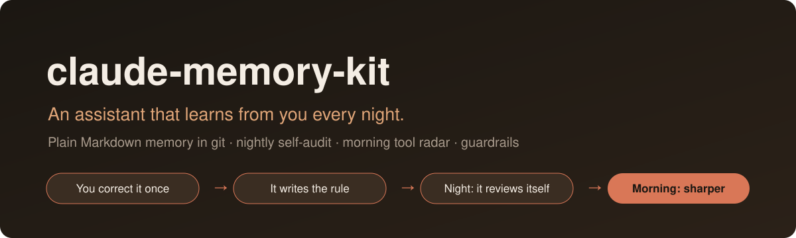

<p align="center"></p>

<p align="center">
  
  
  
  &nbsp;·&nbsp; <a href="README.fr.md">Version française</a>
</p>

## Stop repeating yourself to Claude.

You told it last week: *shorter answers*, *never sign my emails*, *the client is called X, not Y*. Today, new session, same mistakes.

**claude-memory-kit turns Claude Code into an assistant that keeps what you teach it — and gets better on its own.** Correct it once, it writes the rule down. Every night it re-reads the day like a coach reviewing a match, fixes its own notes and builds the small tools it was missing. Every morning it tells you what would have helped you yesterday.

No database, no account, no cloud service. Plain Markdown in a git folder you can read, edit and roll back — fenced by guards that keep your secrets out and ask before anything leaves your machine.

Made for **people who use Claude Code as a daily work assistant** — marketing, operations, consulting, research, freelancing — not only for coding. I built it for myself (I am not a developer) and it runs my own assistant every day.

## Before / after

| Without the kit | With the kit |
|---|---|
| Every session starts from zero | Every session starts with your index, your rules and your projects loaded |
| You repeat the same corrections | A correction becomes a dated rule, applied from the next reply |
| Mistakes you didn't spot are lost | A nightly audit catches what slipped through and writes the missing rules |
| "There must be a tool for this…" | A morning radar suggests 5 tools matched to what you actually did — one command to install |
| A pasted API key ends up in your notes | A filter blocks the commit; a guard warns you when you paste it |
| A web page tells Claude to "send this file" | After reading outside content, anything that sends, publishes or deletes needs your OK |

## Three things it does

**🧠 It remembers.** Plain Markdown notes — index, preferences, profile, projects, daily journal, long-running workstreams — loaded at every start (kept short so it is never truncated) and committed to git after every reply.

**📈 It learns.** "A mistake corrected twice becomes a rule." Corrections are written the moment you make them; the night audit reviews yesterday's conversations; self-tooling builds the missing hooks and scripts, tests everything and rolls back on failure.

**🛡️ It protects.** Secret filter on every commit, secret-paste warning, prompt-injection guard, cost guard for expensive resumes. Night jobs run with explicit tool lists, no MCP servers, and cannot touch their own rules. Changes to `.claude/` are only staged — you confirm them.

## A day with the kit

| When | What happens |
|---|---|
| **05:00** | The audit re-reads yesterday's conversations: rules you had to repeat, facts you explained twice, needless questions. It writes them down and lists the tools that were missing. |
| **Right after** | Self-tooling builds those tools, checks that everything still works, and rolls back otherwise. |
| **06:00** | The radar picks 5 skills, plugins or techniques that would have helped with *your* yesterday — verified sources only. |
| **You start Claude** | Date, index, your preferences, the audit summary and the radar are already loaded. You just work. |
| **All day** | Every correction is saved in seconds; every reply is committed to git; secrets never make it in. |

Times come from `cron.example`; change them freely. The night jobs are optional — the memory, learning-on-correction and guards work on any laptop.

### What a session start looks like

```
Today: 2026-11-23
# Memory index
## Where to find what
| I am looking for… | Note |
| How to answer: tone, length, habits | preferences.md |
| Projects and deadlines              | projects.md    |
…
User preferences (apply from the first reply):
- Answers: short and precise; the result first, the explanation after.
- Never ask "do you want me to…" for a safe, reversible action: do it. (2026-11-20, audit)
Last audit (memory/audit/2026-11-22.md):
Summary: 2 rules · 1 fact · 1 tooling need — stop re-asking for info already in notes
Today's radar (memory/radar/2026-11-23.md):
Summary: 1. PDF table extraction skill · 2. Calendar MCP server · …
```
*(Real output of `scripts/startup.sh`; the preference, audit and radar lines are illustrative.)*

## Get started in 2 minutes

```bash
git clone https://github.com/lucguignard/claude-memory-kit.git
cd claude-memory-kit && ./install.sh ~/assistant   # never overwrites an existing file
cd ~/assistant && claude
```

Then just tell Claude about yourself and how you like to work — it fills in `memory/profile.md` and `memory/preferences.md` for you.

Claude Code asks you to trust the folder's hooks the first time: read `.claude/settings.json` (it only calls the scripts in `scripts/`), then accept.

Requirements: Claude Code, bash, git, jq (`brew install jq` on macOS). Tested on Linux; the scripts avoid GNU-only options so they also run on macOS (bash 3.2) — macOS reports welcome. The night jobs need a machine that is on at night (cron on Linux; on a Mac, cron works but the machine must be awake).

## How it compares

| | Typical memory plugin | claude-memory-kit |
|---|---|---|
| Storage | Database or vector store | Plain Markdown in git: readable, editable, revertable |
| Learning | Recalls what was said | Turns corrections into rules; nightly audit catches what slipped |
| Tooling | — | Builds missing hooks/scripts at night, checks them, rolls back on failure |
| Discovery | — | Morning radar: tools matched to what you actually did |
| Safety | — | Secret filter on every commit, prompt-injection guard, cost guard, `.claude/` changes staged for your OK |

## FAQ

**Is it only for developers?**
No. It was built by and for someone who uses Claude Code for writing, planning and running projects. You talk to Claude; it maintains the files.

**Do I need a server?**
No. Everything except the night jobs works on a laptop. The night jobs need a machine that is on (and awake) at night.

**What do the night jobs cost?**
They use your Claude Code subscription or API like any session, with Sonnet by default to keep usage down (change it in `kit.conf`). Skip them entirely if you prefer.

**Where does my data go?**
Nowhere new: it stays in a local git folder. Only what Claude Code itself sends leaves your machine, plus optional ntfy phone alerts with generic text (no conversation content).

**Can it break my setup at night?**
Night jobs can't edit `CLAUDE.md`, the autosave or the filter, and Claude Code's own `.claude/` protection is respected: changes there wait in `staged/` for your confirmation. Anything self-tooling builds is checked and rolled back on failure.

**Does it work on macOS?**
The scripts avoid GNU-only options and target bash 3.2, but my daily use is on Linux. macOS reports are welcome.

**How is it different from a memory MCP server?**
Those store and recall. This one closes the loop: corrections become rules, the audit finds what you didn't flag, and the radar brings new tools — all in files you can read.

## Under the hood

<details>
<summary><b>Everything in the kit</b></summary>

| Piece | What it does |
|---|---|
| `memory/` | Plain Markdown notes: `INDEX.md` (where to find what), `preferences.md`, `profile.md`, `projects.md`, a daily `journal/`, multi-session `workstreams/`. |
| `CLAUDE.md` | The rules Claude follows: read the index first, write every durable correction to `preferences.md` immediately, "a mistake corrected twice becomes a rule", invent nothing. |
| **startup** hook | Prints today's date, the index and the top of your preferences at each session start (kept under 9,000 characters so it is never truncated). |
| **autosave** hook | Commits `memory/` to local git after every reply. Files over 5 MB are skipped. |
| **filter** | Blocks the commit if the diff contains a password, an API key (Anthropic, OpenAI, GitHub, AWS, Google, Slack…), an IBAN, a card number, or a personal email / phone number. Add your own patterns in `filter-custom.txt`, allowed generic contacts in `filter-allow.txt`. |
| **guard-secret** | Warns when you paste a secret into a prompt (without repeating it). |
| **guard-injection** | Once a session has read outside content (web page, PDF, connector), any action that sends, publishes, pushes or deletes requires your confirmation. |
| **guard-reply** | Nudges Claude once when a reply ends with "do you want me to…?" for a safe action, or hands verification back to you. |
| **guard-cost** | Warns when you resume a very long conversation after the prompt cache has expired. |
| **pre/post-compact** | Tells the compaction summary what to keep, then points back to the active workstream. |
| **notify** | Optional phone alerts through [ntfy](https://ntfy.sh) when Claude waits for you or a night job fails. |
| **nightly audit** (optional) | Re-reads yesterday's conversations, writes missing rules and facts, and lists tooling needs. |
| **self-tooling** (optional) | Builds those tools (hooks, scripts), checks that everything still works, and rolls back otherwise. Changes to `.claude/` are only *staged*, for you to confirm. |
| **radar** (optional) | Every morning, 5 skills, plugins or techniques that would have helped with what you actually did yesterday — verified sources only. `radar-install.sh <date> <n>` installs one. |

</details>

<details>
<summary><b>Setting up the night jobs</b></summary>

```bash
claude setup-token     # long-lived token for unattended runs
mkdir -p ~/.config/claude-memory-kit
echo 'export CLAUDE_CODE_OAUTH_TOKEN=…' > ~/.config/claude-memory-kit/token.env
chmod 600 ~/.config/claude-memory-kit/token.env
crontab -e             # paste the lines from cron.example
```

Settings live in `kit.conf`: time zone, ntfy topic, model for the night jobs (Sonnet by default, to keep costs down).

</details>

<details>
<summary><b>How it learns, step by step</b></summary>

1. You correct Claude ("shorter", "never say X").
2. Claude writes a dated bullet in `memory/preferences.md` right away and tells you in one line.
3. The Stop hook commits it; the next session loads it at startup.
4. At night, the audit catches what slipped through: repeated mistakes, useless questions, facts you had to explain twice.

</details>

<details>
<summary><b>Safety model</b></summary>

- Nothing leaves your machine except what Claude Code itself sends, and the optional ntfy alerts (generic text, no conversation content).
- Unattended runs use explicit `--allowedTools` lists, no MCP servers (`--strict-mcp-config`), and cannot touch `CLAUDE.md`, the autosave or the filter.
- Claude Code protects `.claude/` from unattended edits; the kit respects that and stages changes in `staged/<date>/`. The next interactive session shows them and asks you before connecting anything.
- The filter is a safety net, not a guarantee: keep real secrets in a password manager.

</details>

<details>
<summary><b>Folder layout</b></summary>

```
your-folder/
├── CLAUDE.md
├── kit.conf
├── .claude/settings.json     hooks
├── scripts/                  hooks, night jobs and their prompts
└── memory/
    ├── INDEX.md  preferences.md  profile.md  projects.md
    ├── journal/  workstreams/  audit/  radar/
```

</details>

## Contributing

Issues and pull requests are welcome — especially macOS reports, new filter patterns and ideas for the audit. See [CHANGELOG.md](CHANGELOG.md).

If the kit saves you from repeating yourself, a ⭐ helps others find it.

## License

MIT
