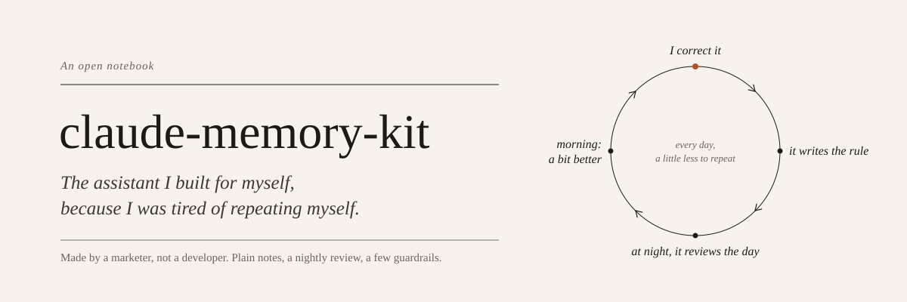

<p align="center"></p>

<p align="center"><i>MIT license · bash, git, jq · <a href="README.fr.md">version française</a></i></p>

---

## Hi, I'm Luc

I'm not a developer. I work in marketing: product ranges, catalogs, social media, customer emails, that kind of stuff. I'm French, so sorry in advance for my English.

A while ago I started using Claude Code as my daily assistant, for work and for personal stuff. And one thing drove me crazy: every new session, it forgot everything. My tone, my rules, my projects, the mistakes I had already corrected the day before. I was repeating myself all day.

So I built something for myself. Well, to be honest, Claude wrote the code. I explained what I wanted, tested everything, and complained a lot when it didn't work.

This repo is the cleaned-up version of that setup. Nothing personal or work-related in it, just the mechanics.

## How I work with it

I just talk to Claude, like I would with a colleague. When something annoys me, I say it once:

> "Stop asking me 'do you want me to…'. If it's safe, just do it."

Claude writes it down right away in a small notes file, with the date, and tells me in one line. Next session, the rule is loaded before I even type. If I have to correct the same thing twice, it becomes a permanent rule. That's the deal.

Then the part I like the most:

- **At 5am**, while I sleep, it re-reads the conversations of the day before. A bit like a coach watching the game replay: where I got annoyed, what I had to explain twice, what it asked me for nothing. It fixes its own notes, and if a small tool was missing, it builds it, checks it, and undoes everything if something breaks.
- **At 6am**, it looks for 5 skills, plugins or tricks that would have helped with what I *actually* did yesterday. Real sources only. If one looks good, one command installs it.
- **When I open Claude in the morning**, all of that is already loaded. I just start working.

It runs on an old Thinkpad at home that stays on all the time. The night part is optional: the rest works on any computer.

This is what the start of a session looks like:

```
Today: 2026-11-23
# Memory index
## Where to find what
| I am looking for… | Note |
| How to answer: tone, length, habits | preferences.md |
| Projects and deadlines              | projects.md    |
…
User preferences (apply from the first reply):
- Answers: short and precise; the result first, the explanation after.
- Never ask "do you want me to…" for a safe, reversible action: do it. (2026-11-20, audit)
Last audit (memory/audit/2026-11-22.md):
Summary: 2 rules · 1 fact · 1 tooling need — stop re-asking for info already in notes
Today's radar (memory/radar/2026-11-23.md):
Summary: 1. PDF table extraction skill · 2. Calendar MCP server · …
```
*(Real output of `scripts/startup.sh`; the preference, audit and radar lines are illustrative.)*

## How I built it

Step by step, one worry at a time. Each piece of the kit answers a question I asked myself while using it:

- *What if I paste an API key by mistake?* → a filter blocks the save if a password, a key, an IBAN or a card number slips in, and I get a warning the moment I paste one.
- *What if a web page tells Claude to send my files somewhere?* → once it has read something from outside, it has to ask me before sending, publishing or deleting anything.
- *What if the night jobs break my setup while I sleep?* → they run with a strict list of allowed tools, can't touch their own rules, and anything touching Claude's settings waits for my OK.
- *Why does coming back to a long conversation after a break cost so much?* → I get a warning and a suggestion to start fresh.

Everything is plain Markdown in a git folder. I can open any note, change it, or go back in time. No database, no account, no cloud service.

## How it can help you

If you use Claude Code for your day-to-day work, and not only for coding, I think it can save you the same frustration. Marketing, operations, consulting, research, freelancing… if you spend your day explaining things to Claude, this is for you.

What you get, concretely:

- **A memory** — Simple notes: an index, your preferences, your profile, your projects, a daily journal. Loaded at every start, saved after every reply.
- **Rules that stick** — Every correction becomes a dated rule. Twice the same mistake = permanent rule.
- **A nightly review** — Catches what you didn't flag, fixes the notes, builds what was missing.
- **A morning radar** — 5 tools matched to your real day, one command to install.
- **Guardrails** — Secret filter, protection against instructions hidden in web pages, cost warning.

## Try it

```bash
git clone https://github.com/lucguignard/claude-memory-kit.git
cd claude-memory-kit && ./install.sh ~/assistant
cd ~/assistant && claude
```

(The installer never overwrites an existing file.) Then introduce yourself to Claude, like you would to a new assistant: what you do, how you like answers, what annoys you. It fills in the notes for you.

The first time, Claude Code asks you to trust the folder's hooks: read `.claude/settings.json` (it only calls the scripts in `scripts/`), then accept.

You need Claude Code, bash, git and jq (`brew install jq` on a Mac).

## Being honest about the limits

- I've only used it on Linux. The scripts are written to work on a Mac too, but I haven't been able to test it. If you try, tell me.
- The night jobs need a computer that is on (and awake) at night, and they use your Claude subscription like a normal session. They run on Sonnet by default to keep it reasonable, and you can skip them completely.
- Your notes stay in a local folder. Only what Claude Code already sends leaves your machine, plus optional phone alerts (through [ntfy](https://ntfy.sh)) with generic text, never the conversation.
- The secret filter is a safety net, not a guarantee. Keep your real passwords in a password manager.
- It's my first open source project. Be kind, but be honest.

## Under the hood

<details>
<summary><b>Everything in the kit</b></summary>

| Piece | What it does |
|---|---|
| `memory/` | Plain Markdown notes: `INDEX.md` (where to find what), `preferences.md`, `profile.md`, `projects.md`, a daily `journal/`, multi-session `workstreams/`. |
| `CLAUDE.md` | The rules Claude follows: read the index first, write every durable correction to `preferences.md` immediately, "a mistake corrected twice becomes a rule", invent nothing. |
| **startup** hook | Prints today's date, the index and the top of your preferences at each session start (kept under 9,000 characters so it is never truncated). |
| **autosave** hook | Commits `memory/` to local git after every reply. Files over 5 MB are skipped. |
| **filter** | Blocks the commit if the diff contains a password, an API key (Anthropic, OpenAI, GitHub, AWS, Google, Slack…), an IBAN, a card number, or a personal email / phone number. Add your own patterns in `filter-custom.txt`, allowed generic contacts in `filter-allow.txt`. |
| **guard-secret** | Warns when you paste a secret into a prompt (without repeating it). |
| **guard-injection** | Once a session has read outside content (web page, PDF, connector), any action that sends, publishes, pushes or deletes requires your confirmation. |
| **guard-reply** | Nudges Claude once when a reply ends with "do you want me to…?" for a safe action, or hands verification back to you. |
| **guard-cost** | Warns when you resume a very long conversation after the prompt cache has expired. |
| **pre/post-compact** | Tells the compaction summary what to keep, then points back to the active workstream. |
| **notify** | Optional phone alerts through [ntfy](https://ntfy.sh) when Claude waits for you or a night job fails. |
| **nightly audit** (optional) | Re-reads yesterday's conversations, writes missing rules and facts, and lists tooling needs. |
| **self-tooling** (optional) | Builds those tools (hooks, scripts), checks that everything still works, and rolls back otherwise. Changes to `.claude/` are only *staged*, for you to confirm. |
| **radar** (optional) | Every morning, 5 skills, plugins or techniques that would have helped with what you actually did yesterday — verified sources only. `radar-install.sh <date> <n>` installs one. |

</details>

<details>
<summary><b>Setting up the night jobs</b></summary>

```bash
claude setup-token     # long-lived token for unattended runs
mkdir -p ~/.config/claude-memory-kit
echo 'export CLAUDE_CODE_OAUTH_TOKEN=…' > ~/.config/claude-memory-kit/token.env
chmod 600 ~/.config/claude-memory-kit/token.env
crontab -e             # paste the lines from cron.example
```

Settings live in `kit.conf`: time zone, ntfy topic, model for the night jobs (Sonnet by default, to keep costs down).

</details>

<details>
<summary><b>How it learns, step by step</b></summary>

1. You correct Claude ("shorter", "never say X").
2. Claude writes a dated bullet in `memory/preferences.md` right away and tells you in one line.
3. The Stop hook commits it; the next session loads it at startup.
4. At night, the audit catches what slipped through: repeated mistakes, useless questions, facts you had to explain twice.

</details>

<details>
<summary><b>Safety model</b></summary>

- Nothing leaves your machine except what Claude Code itself sends, and the optional ntfy alerts (generic text, no conversation content).
- Unattended runs use explicit `--allowedTools` lists, no MCP servers (`--strict-mcp-config`), and cannot touch `CLAUDE.md`, the autosave or the filter.
- Claude Code protects `.claude/` from unattended edits; the kit respects that and stages changes in `staged/<date>/`. The next interactive session shows them and asks you before connecting anything.
- The filter is a safety net, not a guarantee: keep real secrets in a password manager.

</details>

<details>
<summary><b>Folder layout</b></summary>

```
your-folder/
├── CLAUDE.md
├── kit.conf
├── .claude/settings.json     hooks
├── scripts/                  hooks, night jobs and their prompts
└── memory/
    ├── INDEX.md  preferences.md  profile.md  projects.md
    ├── journal/  workstreams/  audit/  radar/
```

</details>


## Talk to me

Any feedback is welcome, good or bad. Open an issue if something doesn't work, if you tried it on a Mac, or if you have an idea for the nightly review. Changes are listed in [CHANGELOG.md](CHANGELOG.md).

If it saves you from repeating yourself, a star helps other people find it. Thanks for reading.

— Luc

## License

MIT
